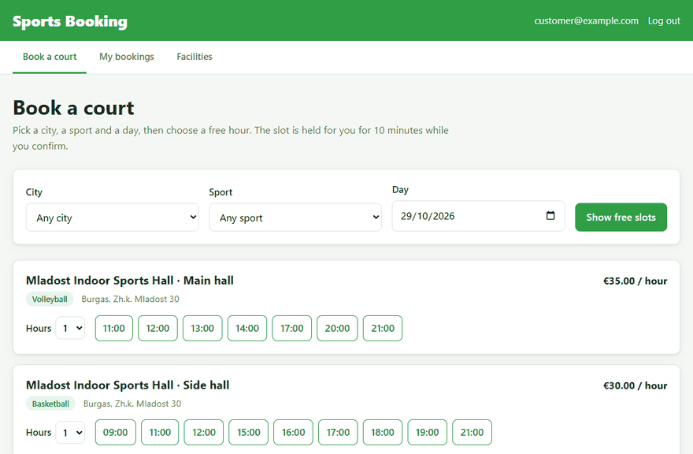
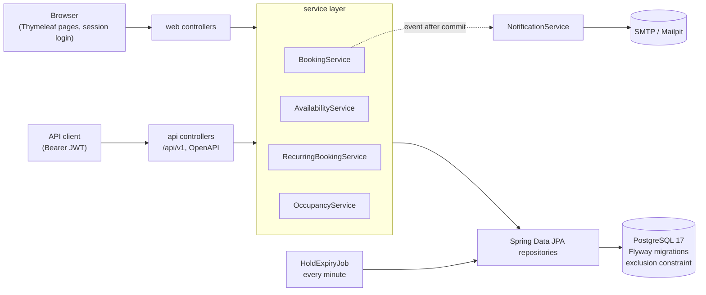
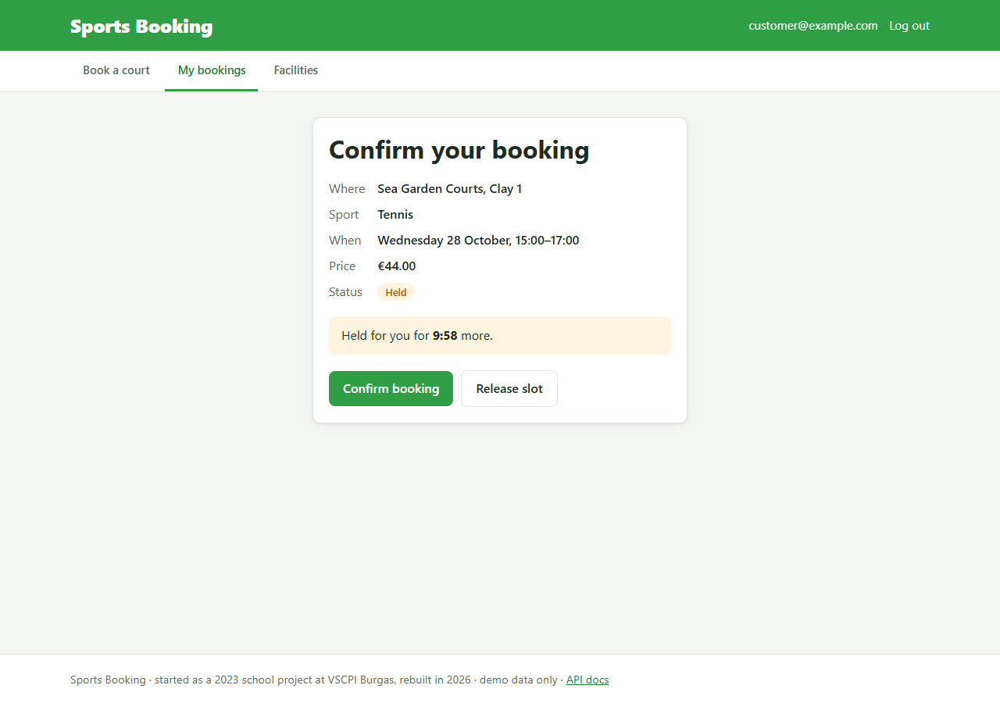
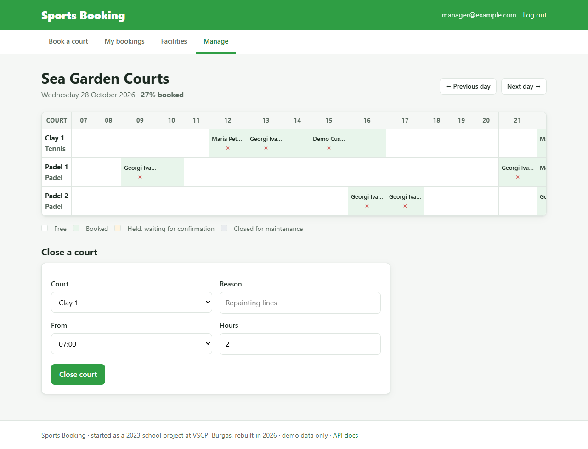

# Sports Booking

Book sports courts by the hour, with no double bookings, even when many people book the same slot at the same moment.

[](https://github.com/KALalev18/sports-booking/actions/workflows/ci.yml)
  

**Live demo:** _add the Render URL here_ · Demo accounts (password `demo1234`): `customer@example.com`, `manager@example.com`, `admin@example.com` · [API docs](https://_render-url_/swagger-ui.html)





## The problem

Booking a pitch or court usually means phoning the facility, and two people asking for the same evening slot at once
can both be told yes. This app lets people see the free hours at every court in a city and book one online. The hard
part is guaranteeing that **one slot is only ever sold once**: two requests for the same hour can arrive in the same
millisecond, and the second one has to be refused cleanly, not crash and not succeed.

## Features

- **Search** free one-hour slots by city, sport and day; each free hour is a button.
- **Hold, then confirm.** Picking a slot holds it for 10 minutes while the customer confirms; unconfirmed holds are
  released by a scheduled job. A customer can hold at most 3 slots at a time, so nobody can lock up every court.
- **Cancellation rule.** Customers cancel for free until 24 hours before the start; managers can cancel any time
  (for example for bad weather), and the customer is emailed.
- **Weekly bookings.** "Every Tuesday 18:00–20:00 for 10 weeks" books every free week and reports the weeks that clash.
- **Three roles.** Customers book; managers see a day grid of their facilities and close courts for maintenance;
  admins manage roles. Managers only see facilities they run.
- **Email** confirmations, sent after the transaction commits (Mailpit catches them locally).
- **REST API** with JWT authentication, OpenAPI/Swagger UI and RFC 9457 problem-detail errors.

| Checkout with the hold timer | Manager's day grid |
| --- | --- |
|  |  |

## Tech stack

| | |
| --- | --- |
| Language and framework | Java 25, Spring Boot 4.1 (Spring MVC, Spring Data JPA / Hibernate 7, Spring Security 7, Bean Validation), virtual threads |
| Database | PostgreSQL 17, Flyway migrations, GiST exclusion constraint (`btree_gist`) |
| API | REST, JWT (OAuth2 resource server, HS256), springdoc OpenAPI / Swagger UI, `ProblemDetail` errors |
| Web UI | Thymeleaf, server-rendered HTML and CSS, a little vanilla JavaScript |
| Testing | JUnit 6, Mockito, AssertJ, MockMvc, Testcontainers (PostgreSQL), JaCoCo coverage |
| Quality and delivery | Spotless (palantir-java-format), Checkstyle, GitHub Actions CI, Docker, Docker Compose, Micrometer / Actuator, k6 load tests |

## Design decisions

**1. The database enforces "no double bookings".** A Java check such as "is this slot free? then insert" fails under
concurrency: two requests can both see the slot as free before either one saves. Instead,
[`V2__bookings.sql`](src/main/resources/db/migration/V2__bookings.sql) adds an exclusion constraint:

```sql
CONSTRAINT booking_no_overlap EXCLUDE USING gist (
    court_id WITH =,
    tstzrange(start_time, end_time, '[)') WITH &&
) WHERE (status IN ('HELD', 'CONFIRMED'))
```

PostgreSQL refuses any second active booking whose time range overlaps another on the same court. Ranges are
half-open (`[)`), so 10:00–11:00 and 11:00–12:00 do not clash, and cancelled or expired rows free their slot. The
service catches the violation (SQLSTATE `23P01`) and returns `409 SLOT_UNAVAILABLE`.

**2. A row lock on the court prevents deadlocks.** The concurrency test found something the constraint alone does
not handle: two inserts for the same slot can each wait for the other's uncommitted row while checking the
constraint, and PostgreSQL aborts one as a deadlock after a one-second timeout. Every booking transaction now locks the
court row first (`SELECT … FOR UPDATE`), so requests for the same court queue up and the losers get a clean 409, while
different courts still book in parallel. The constraint remains the guarantee; the lock makes failures clean and fast.

**3. Holds expire in two ways.** A scheduled job marks run-out holds as `EXPIRED` every minute, but correctness does not
depend on it: search treats a run-out hold as free, and a new booking for that time releases it in the same
transaction. Confirm, cancel and expire all bump a `@Version` column, so a confirm based on a stale read loses
to the expiry instead of overwriting it.

**4. Times are stored in UTC and shown in the facility's time zone.** Opening hours are local (`08:00–22:00` in
`Europe/Sofia`); bookings are `timestamptz`. A unit test checks that 18:00 in Sofia is 15:00 UTC in summer and
16:00 UTC in winter. Every rule reads time from an injected `Clock`, so tests can move time forward instead of
sleeping.

**5. Two security chains.** `/api/**` is stateless with Bearer JWTs (no cookies, so no CSRF); the website uses a
session and CSRF tokens. Facility-level rules ("a manager may only touch their own facilities") are `@PreAuthorize`
checks on service methods, so they apply to both the API and the site.

**6. Services return read-only views.** Controllers get records like `BookingView` built inside the transaction, never
JPA entities, so nothing outside the service layer can trigger lazy loading or change data by accident.
`open-in-view` is off.

**7. Emails never break a booking.** They are sent from `@TransactionalEventListener` handlers after the commit, on
another thread: a rolled-back booking sends nothing, and a mail server outage only logs a warning.

**Trade-offs.** Bookings are whole hours, which keeps search simple. Thymeleaf instead of a separate frontend keeps
the project focused on the backend. HS256 with one shared key works because this app both issues and checks its
tokens; with a separate auth service you would use RS256 and publish the public key.

## Measured results

On a laptop (Ryzen 7 4800H, everything in Docker), with **441,277 bookings across 1,011 courts**. Full commands
and output are in [`perf/RESULTS.md`](perf/RESULTS.md).

| What | Result |
| --- | --- |
| 100 simultaneous HTTP requests for one free slot (k6) | **1 booked, 99 refused with 409** |
| 50 threads, same slot, in the test suite (repeated 5 times per run) | exactly 1 succeeds every time |
| Search: 20 users, random city (100 courts) and day, 60 s | **593 req/s, p95 46 ms**, 0 errors |
| Holds: 50 customers, random slots, 60 s | **568 attempts/s, p95 78 ms** (368/s held, 199/s correctly refused) |
| Search query for 100 courts, `EXPLAIN ANALYZE` | 10.8 ms, uses the constraint's GiST index |
| Tests | 70 (23 unit, 47 integration on PostgreSQL), line coverage 78.9%, service layer 89.5% |

## Run it locally

You need **Java 25** and **Docker**. Maven is not needed; the wrapper downloads it.

```bash
git clone https://github.com/KALalev18/sports-booking.git
cd sports-booking
./mvnw spring-boot:run          # Windows: mvnw.cmd spring-boot:run
```

Spring Boot starts PostgreSQL and Mailpit from [`compose.yaml`](compose.yaml), runs the Flyway migrations and fills
the database with demo data. Then open:

- http://localhost:8080: the site (log in as `customer@example.com` / `demo1234`, or manager / admin)
- http://localhost:8080/swagger-ui.html: the API
- http://localhost:8025: Mailpit, where the confirmation emails land

To run everything in Docker without Java installed: `docker compose --profile app up --build`.

### API example

```bash
TOKEN=$(curl -s -X POST localhost:8080/api/v1/auth/token -H 'Content-Type: application/json' \
  -d '{"email":"customer@example.com","password":"demo1234"}' | jq -r .accessToken)

curl -s "localhost:8080/api/v1/availability?date=2026-11-03&city=Varna&sport=PADEL"

curl -s -X POST localhost:8080/api/v1/bookings -H "Authorization: Bearer $TOKEN" \
  -H 'Content-Type: application/json' -d '{"courtId":9,"date":"2026-11-03","start":"18:00","hours":2}'
# 201 {"id":…,"status":"HELD","price":56.00,"holdExpiresAt":"…"}   or   409 {"code":"SLOT_UNAVAILABLE",…}
```

Configuration is through environment variables; see [`.env.example`](.env.example).

## Tests

```bash
./mvnw verify
```

Runs Checkstyle and Spotless, the unit tests, and the integration tests against a real PostgreSQL 17 in
Testcontainers (Docker must be running). The JaCoCo report is written to `target/site/jacoco/index.html`.
GitHub Actions runs the same command on every push.

Highlights:
[`ConcurrentBookingIT`](src/test/java/com/kalalev/booking/service/ConcurrentBookingIT.java) (50 threads, one slot),
[`ExclusionConstraintIT`](src/test/java/com/kalalev/booking/repository/ExclusionConstraintIT.java) (the constraint on its
own, in plain SQL), [`HoldExpiryJobIT`](src/test/java/com/kalalev/booking/service/HoldExpiryJobIT.java) (optimistic
locking against the expiry job), [`BookingApiIT`](src/test/java/com/kalalev/booking/api/BookingApiIT.java) (JWT, 401/403/409/422).

## Project structure

```
src/main/java/com/kalalev/booking
├── api/          REST controllers, ProblemDetail error handler, OpenAPI config
├── web/          Thymeleaf page controllers
├── service/      booking rules, availability, recurring bookings, occupancy, email, expiry job
├── domain/       JPA entities: Booking, Court, Facility, AppUser, RecurringSeries
├── repository/   Spring Data JPA repositories, native queries for range overlap
├── security/     two filter chains, JWT config, facility access checks
└── config/       clock, booking settings, demo data
src/main/resources/db/migration   Flyway: V1 users/facilities/courts, V2 bookings + constraint, V3 recurring
src/test/java/...                 unit tests (*Test) and Testcontainers integration tests (*IT)
perf/                             load-test dataset, k6 scripts, results
```

## What I'd do next

- **Cancel a whole weekly series** at once, and one summary email for it.
- **Rate limiting** on login and holds (for example Bucket4j), and account lockout after repeated failed logins.
- **Payments** for confirmed bookings and a refund rule for late cancellations.
- **Opening hours per weekday** and holiday closures, instead of the same hours every day.
- **Read replicas or caching** for search if traffic grew; today one query per search is fast enough.
- **Observability:** export the Micrometer metrics (holds created, expired, refused) to Prometheus and Grafana.

## Project history

This started in 2023 as my diploma project for the state matriculation exam in applied programming at the Vocational
School of Computer Programming and Innovations (VSCPI) in Burgas: a sports facilities website with a shop and an
admin panel, written in Spring Boot 3.0 and SQL Server. Much of it never ran. In 2026 I rebuilt it around the hardest
problem in that domain, booking courts by the hour safely under concurrency. The early commits in the history are the
original school project.

## License

[MIT](LICENSE)
