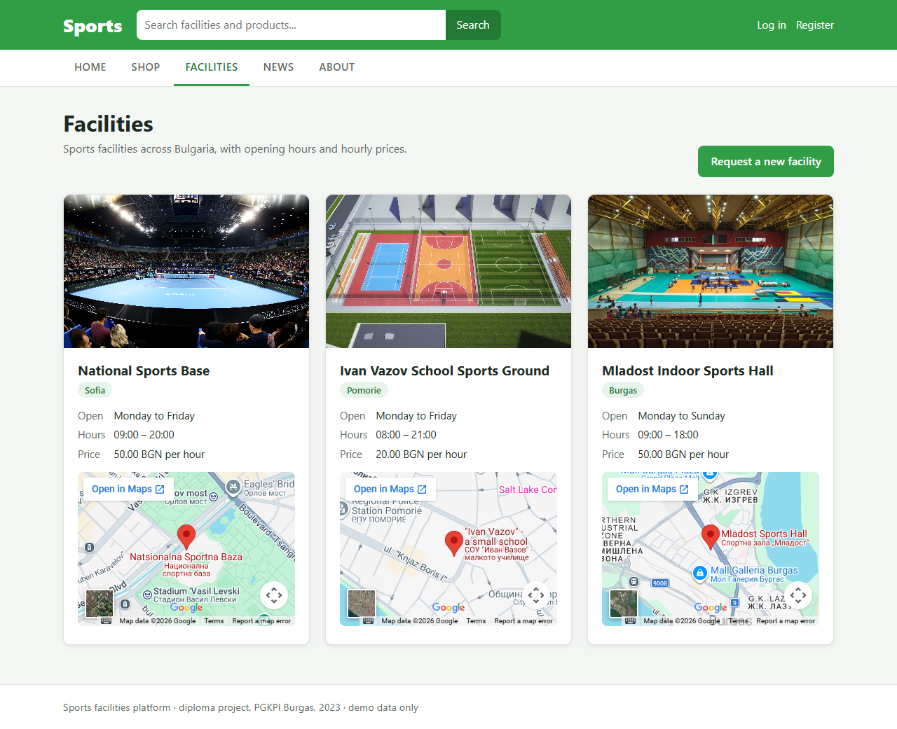
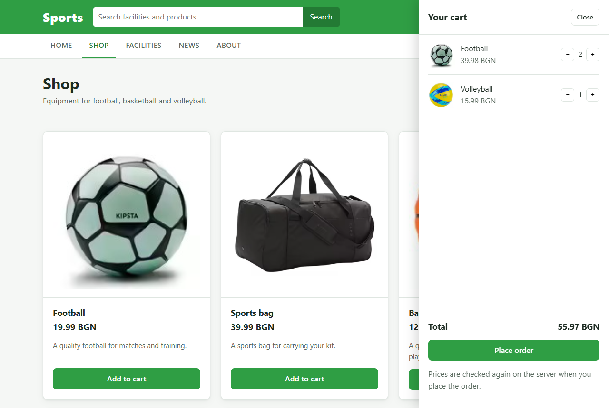
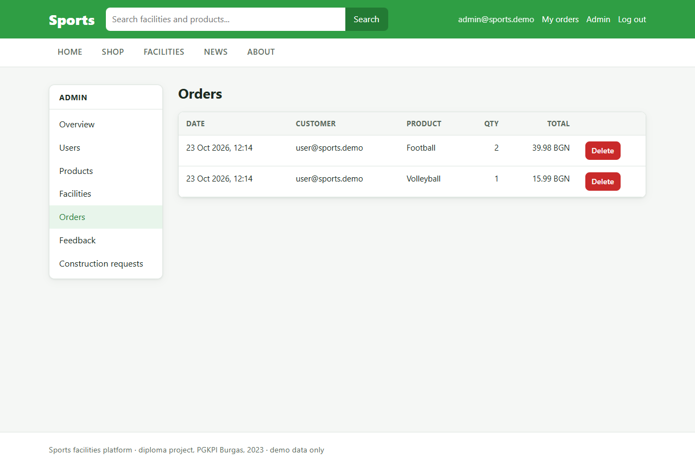
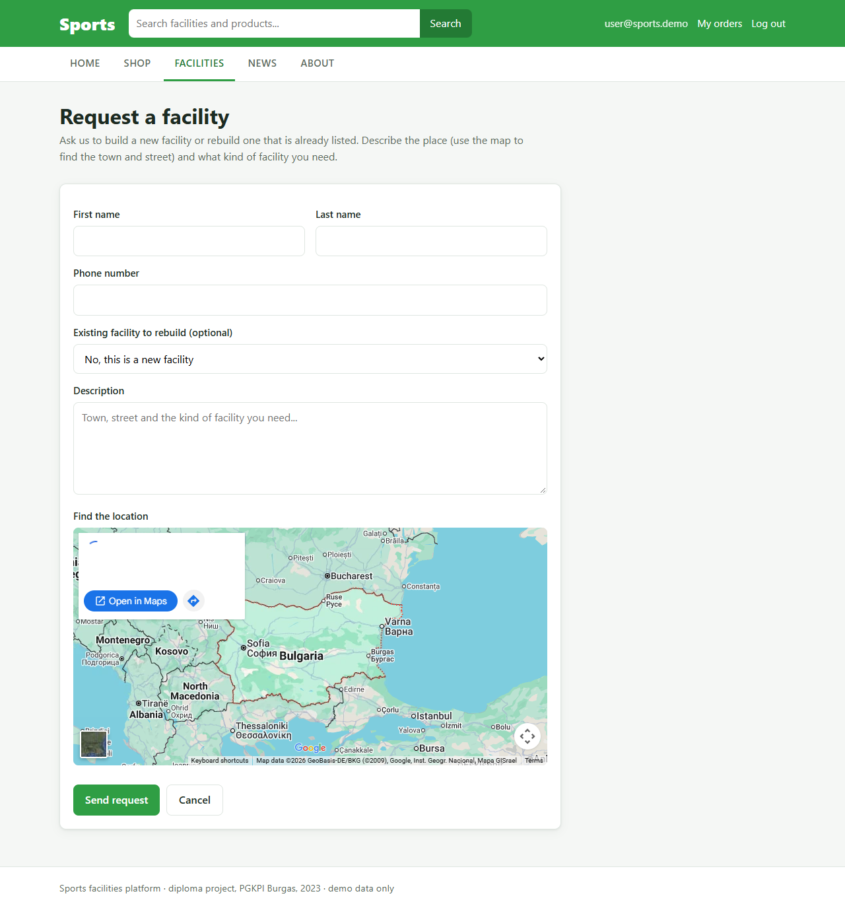
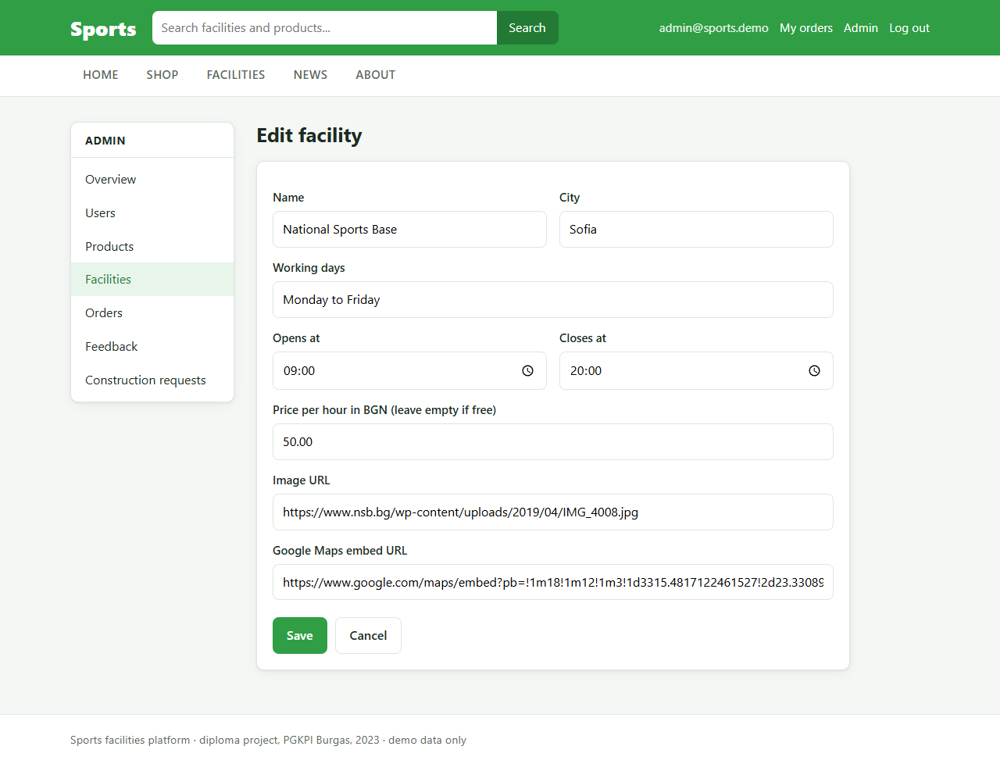
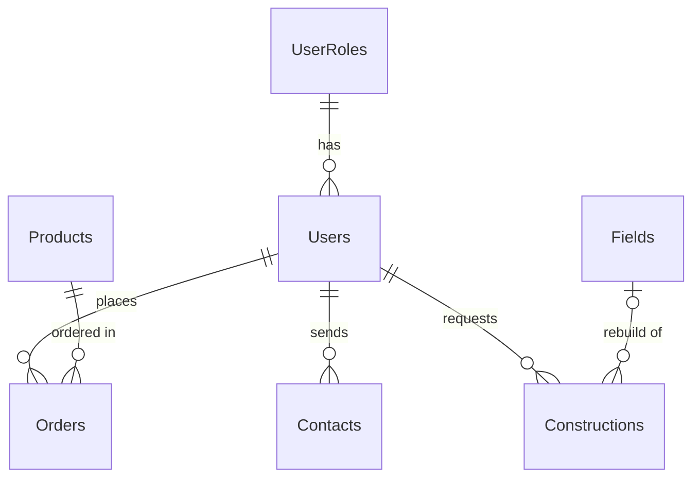

# Sports Facilities Platform

A Spring Boot web app where people find sports facilities in Bulgaria, order sports equipment, and request new or rebuilt facilities, with an admin panel to manage it all.

[](https://github.com/KALalev18/SportsProject/actions/workflows/ci.yml)

**Live demo:** _add the Render URL here_ · Demo accounts: `user@sports.demo` / `user12345` and `admin@sports.demo` / `admin12345` (the demo runs on an in-memory database that resets when the server restarts)



## The problem

Many towns in Bulgaria have few good sports facilities, and information about the ones that exist (where they are, when they are open, what they cost) is spread across many places. This project puts three things in one site:

- a list of facilities with opening days, hours, hourly price and a map
- a small shop for sports equipment
- a form where a town or resident can ask for a new facility or the rebuild of an existing one

It started as my diploma project for the state matriculation exam in applied programming (PGKPI Burgas, 2023).

## Features

- **Accounts and roles:** registration and login with Spring Security. Passwords are stored as BCrypt hashes. Users have the `USER` or `ADMIN` role, and everything under `/admin` needs `ADMIN`.
- **Facilities:** cards loaded from the database with city, working days and hours, price per hour (or "Free") and an embedded Google Map.
- **Shop and checkout:** the cart lives in the browser (localStorage). At checkout only product ids and quantities are sent. The server looks up the prices, checks quantities (1 to 99), and saves all order lines in one transaction.
- **Order history:** each user sees their own orders under "My orders".
- **Construction requests:** logged-in users ask for a new facility, or pick an existing one to be rebuilt.
- **Feedback form** on the About page, saved to the database.
- **Search** across facility names, cities and products.
- **Admin panel:** overview counts; add, edit and delete products and facilities; change user roles or delete users; review and delete orders, feedback and construction requests.

| Shop with cart | Admin: orders |
| --- | --- |
|  |  |
| **Construction request** | **Admin: edit facility** |
|  |  |

## Tech stack

| Layer | Technologies |
| --- | --- |
| Backend | Java 25, Spring Boot 3.5, Spring MVC, Spring Data JPA (Hibernate), Spring Security, Bean Validation |
| Frontend | Thymeleaf templates, HTML, CSS, vanilla JavaScript (cart) |
| Database | Microsoft SQL Server (`sqlserver` profile), H2 in-memory (default profile, tests and demo) |
| Testing | JUnit 5, Mockito, AssertJ, Spring Boot Test, MockMvc, Spring Security Test |
| Tooling | Maven Wrapper, Spotless (palantir-java-format), GitHub Actions, Docker, Docker Compose |

## How it is built

The app follows the MVC pattern with three layers below the controllers, as described in the thesis:

```
Browser ── Thymeleaf views ── Controllers ── Services ── Repositories ── Database
                                (web)      (business rules)  (Spring Data JPA)
```

- **Controllers** (`controller`, `controller/admin`) handle requests and pick a view. Forms bind straight to entities, but `@InitBinder` whitelists the fields a form may set, so a user cannot post an id or a user field to overwrite someone else's data.
- **Services** (`service`, `service/impl`) hold the rules: unique email and password hashing at registration, server-side order pricing, and cleanup of rows that reference a deleted user or facility.
- **Repositories** (`repository`) are Spring Data JPA interfaces. Queries such as `findByUserOrderByOrderDateDesc` are derived from the method names.

The data model follows the database diagram from the thesis:



`Orders` stores one row per product in a checkout, with the quantity and the line total, as in the original schema. Prices use `DECIMAL(10,2)` and `BigDecimal` rather than floating point.

## Run it locally

You need **Java 25** or newer. Maven is not needed, because the wrapper downloads it.

```bash
git clone https://github.com/KALalev18/SportsProject.git
cd SportsProject
./mvnw spring-boot:run        # on Windows: mvnw.cmd spring-boot:run
```

Open http://localhost:8080. The default profile uses an in-memory H2 database and fills it with the demo accounts, six products and three facilities, so no setup is needed.

### With Microsoft SQL Server

Docker Compose starts SQL Server 2022, creates the `SportsDb` database and runs the app with the `sqlserver` profile:

```bash
cp .env.example .env          # then set DB_PASSWORD to a strong password
docker compose up --build
```

To use your own SQL Server instead, set `DB_URL`, `DB_USERNAME` and `DB_PASSWORD` (see `.env.example`) and run `./mvnw spring-boot:run -Dspring-boot.run.profiles=sqlserver`. Hibernate creates the tables on first start.

| Variable | Used for | Default |
| --- | --- | --- |
| `DB_URL`, `DB_USERNAME`, `DB_PASSWORD` | SQL Server connection (`sqlserver` profile only) | none |
| `DEMO_ADMIN_EMAIL`, `DEMO_ADMIN_PASSWORD` | Admin account created on an empty database | `admin@sports.demo` / `admin12345` |
| `DEMO_USER_EMAIL`, `DEMO_USER_PASSWORD` | User account created on an empty database | `user@sports.demo` / `user12345` |
| `PORT` | HTTP port | `8080` |

## Tests

```bash
./mvnw verify
```

This checks formatting and runs 44 tests (unit, `@DataJpaTest` repository tests and MockMvc tests on H2). GitHub Actions runs the same command on every push. The tests cover:

- order pricing from the database, quantity limits, and that nothing is saved when one cart line is invalid
- registration: BCrypt hashing, duplicate email, mismatched passwords
- database constraints: required fields and unique email
- access rules: public pages, login redirects, `403` for non-admins on `/admin`, CSRF tokens required
- a checkout that sends a fake price, and a form post that tries to overwrite another row; both are ignored

To format the code: `./mvnw spotless:apply`.

## Project structure

```
src/main/java/com/kalalev/sports
├── config/          AppConfig (clock), DataSeeder (demo data)
├── content/         ServiceCatalog: the six construction service pages
├── controller/      public pages, auth, shop, facilities, feedback
│   └── admin/       admin panel controllers
├── dto/             RegistrationForm, CartItem
├── exception/       NotFoundException (404), InvalidOrderException, ...
├── model/           JPA entities: User, UserRole, Product, Order, Field, Contact, Construction
├── repository/      Spring Data JPA repositories
├── security/        SecurityConfig, login by email, safe redirect after login
└── service/         service interfaces, with implementations in impl/
src/main/resources
├── templates/       Thymeleaf views (layout, public pages, admin/)
├── static/          CSS, cart JavaScript, product images
└── application*.properties
src/test/java/...    unit, repository and web tests
```

## Project history

I built the first version in 2023 for my diploma at the Professional High School of Computer Programming and Innovations (PGKPI) in Burgas. The thesis (in Bulgarian) describes the requirements, the UML and database diagrams, and the MVC design.

In 2026 I came back to it to finish it properly. The original code had problems that kept most of it from running:
- Spring never loaded the controllers and entities, because the main class was in a different package.
- The entity mappings would have stopped Hibernate from starting.
- Login and the shop were front-end only.
- The tests could not pass.

I kept the design and the database model from the thesis, and changed the following:
- fixed the mappings and package structure
- added Spring Security
- moved the pages into Thymeleaf templates and translated them to English
- moved the shop and orders to the database
- added the admin panel, real tests, CI and Docker

## What I would improve next

- **Hourly booking of facilities.** This was planned in the thesis but not built. It needs a bookings table and checks for overlapping time slots.
- **Uploads and editable news.** Image upload for products and facilities, instead of image URLs and file names. News is static HTML today and could move to the database with an admin editor.
- **Database migrations.** Flyway instead of `ddl-auto=update`, so schema changes are versioned.
- **Account management.** Users editing or deleting their own account, and password reset by email.
- **Hosted images.** Facility and service photos are linked from their original websites. They should be replaced with images the project has the rights to.
- **Order statuses** (placed, shipped, delivered) and a real payment step.

## License

[MIT](LICENSE)
